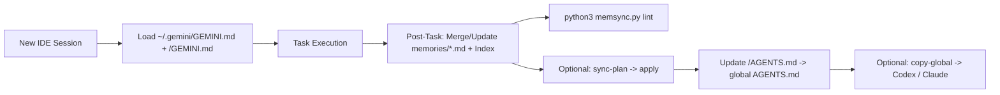

<div align="center">

# MilkFrog Memory Skill


**A skill that teaches your AI agent to install, migrate, and verify a local dual-layer Markdown memory system (`GEMINI.md` + optional `AGENTS.md` cache).**

[中文文档](./README.zh-CN.md) | [Installer Skill](./SKILL.md) | [Architecture](./references/architecture.md) | [Demo Vault](./examples/milkfrog-demo/)

</div>

---

## Support Scope

- **Supported Host**: **Google Antigravity IDE** (rules discovery + optional scheduled background sidecar), plus optional one-way snapshot copy to Codex / Claude Code (`~/.codex/AGENTS.md`, `~/.claude/CLAUDE.md`).
- **Not Supported Yet**: **Antigravity CLI (`agy`)** has not been adapted or tested.

---

## Why Another Memory System?

Vector RAG or raw transcript search answers *"what did we discuss two weeks ago?"*, not *"follow my formatting rules, port mappings, and repo constraints before touching code."*

This skill installs a plain-Markdown, zero-API-call memory architecture split into two layers:

1. **Source of Truth (`GEMINI.md` + `memories/*.md`)**: Curated post-task notes categorized into `user`, `feedback`, `project`, and `reference`, separated cleanly into global vs per-workspace scopes.
2. **Optional Hot Cache (`AGENTS.md` + `memsync.py`)**: A pure-stdlib Python utility hashes files in `sync-state.json`, computes incremental diffs (`[NEW]` / `[MODIFIED]` / `[DELETED]`), skips unchanged scopes, guards against secret leaks, and keeps `AGENTS.md` snapshots synced (either on demand or via an optional Antigravity daily cron sidecar).

Once setup finishes, **daily memory operations live inside `~/.gemini/GEMINI.md` itself** — you can disable or delete this skill and the system keeps working.

---

## Two Modes Out of the Box

| Capability | Dual-Layer (`agents_cache_enabled: true`) | Index-Only (`agents_cache_enabled: false`) |
| --- | --- | --- |
| Global & Workspace `GEMINI.md` + `memories/*.md` | Yes | Yes |
| `AGENTS.md` Hot Snapshot Cache | Yes | Skipped (leaves existing `AGENTS.md` untouched) |
| Incremental Diff & `apply` Sync | Optional daily cron or manual trigger | Disabled |
| Cross-Tool Copy (`~/.codex`, `~/.claude`) | Optional one-way mirror | Disabled |
| Context Footprint | Higher (cached digest always loaded) | Minimal (index lines loaded; bodies read on demand) |

Both modes enforce Antigravity's native `24,000`-byte per-file cap by default (`limits.profile = "standard"`), with an `"extended"` profile for users who expanded IDE limits.

---

## Architecture Flow



---

## Quick Start

1. Clone this repository into your Antigravity skills folder (or open it directly and tell the agent to install from `SKILL.md`):

   ```bash
   git clone https://github.com/milkfrogdev/milkfrog-memory-skill.git ~/.gemini/config/skills/milkfrog-memory
   ```

   *(Workspace-local alternative: clone into `<your-project>/.agents/skills/milkfrog-memory`.)*

2. Start a conversation in **Antigravity IDE** and tell your agent:

   > Install the `milkfrog-memory` skill for me.

3. Your agent will:
   - Run `memsync.py doctor --json` (read-only) to inspect Python, OS, timezone, existing `GEMINI.md` / `AGENTS.md`, and external tools.
   - Ask which mode (`Dual-Layer` vs `Index-Only`), schedule preference, budget profile (`24 KB standard` vs `extended`), and migration strategy for any existing rules (Translate/Migrate with a Keep/Drop review table [Recommended], Preserve unmanaged, or Ignore).
   - Copy `memsync.py` and offline `DESIGN.md` to `~/.gemini/memory-ops/`, configure `config.json`, write self-contained `~/.gemini/GEMINI.md`, optionally create the `sidecar.json` automation definition (without force-enabling it), and verify `lint` passes with `errors=0`.

---

## Repository Structure

```text
milkfrog-memory-skill/
├── SKILL.md                      # Agent installation & migration runbook (English)
├── SKILL.zh-CN.md                # Agent installation & migration runbook (Chinese)
├── scripts/
│   └── memsync.py                # Stdlib-only Python >=3.9 operations CLI
├── templates/
│   ├── en/                       # Global GEMINI.md (full / index-only) & RUNBOOK.md
│   ├── zh/                       # Chinese counterparts
│   └── shared/                   # Entry frontmatter template & Antigravity sidecar template
├── references/
│   ├── architecture.md           # Design rationale & trade-offs (+ .zh-CN.md)
│   ├── schema-and-config.md      # config.json flags & CLI spec (+ .zh-CN.md)
│   └── troubleshooting.md        # Mode switching, 24KB limit, rollback (+ .zh-CN.md)
├── examples/milkfrog-demo/       # Sanitized MilkFrog sample vaults (en + zh)
└── tests/test_memsync.py         # Isolated unit test suite using temporary HOME
```

---

## Running Tests Safely

All tests isolate `MILKFROG_MEMORY_HOME` inside temporary directories and never touch your real `~/.gemini` folder:

```bash
python3 -m unittest discover -s tests -p "test_*.py"
```

---

## License

MIT — [MilkFrog (`milkfrogdev`)](./LICENSE) · Xiaohongshu: **程序员奶蛙**
