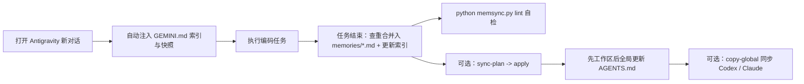

<div align="center">

# MilkFrog 双层记忆系统 Skill


**一个让 AI 自己动手把双层本地记忆系统（`GEMINI.md` 索引正文 + 可选 `AGENTS.md` 热缓存）装进你电脑的开源 Skill。**

[English README](./README.md) | [安装向导 SKILL](./SKILL.zh-CN.md) | [架构设计](./references/architecture.zh-CN.md) | [程序员奶蛙示例库](./examples/milkfrog-demo/)

</div>

---

## 适用边界（先看清楚再装）

- **当前支持**：**Google Antigravity IDE**（完整规则发现 + 可选后台定时同步），并支持在更新全局快照后单向备份同步给 Codex / Claude Code（`~/.codex/AGENTS.md`、`~/.claude/CLAUDE.md`）。
- **暂不支持**：**Antigravity CLI（`agy`）** 尚未做过适配与实测。

---

## 它解决什么问题

向量检索或翻历史对话能帮你找到「两周前讨论过什么」，却管不住 AI 在动手前「遵守你的工程红线」。

这套记忆方案不接外部向量库、不调外部摘要 API，所有数据留在你本机 Markdown 里，按职责拆成两层：

1. **索引与真相源（`GEMINI.md` + `memories/*.md`）**：每次任务做完由 Agent 裁决沉淀，只留长期有用的事实，拆成 `user / feedback / project / reference` 四类，全局和单项目各管各的。
2. **可选热缓存（`AGENTS.md` + `memsync.py`）**：纯标准库 Python 脚本按 `sha256` 检测增量变化，跳过零改动作用域、拦截疑似明文密钥，在你需要时或每天定时把变动部分蒸馏进紧凑的 `AGENTS.md` 快照。

安装验收通过后，**日常读写规则全部内嵌进 `~/.gemini/GEMINI.md` 头部**——哪怕你事后把本 Skill 删掉，记忆系统照常运转。只有做二次开发或调整阈值时才需要回看设计文档（安装时会一并拷贝一份 `DESIGN.md` 留在本地）。

---

## 两种运行模式（安装时按需自选）

| 能力项 | 双层模式（`agents_cache_enabled: true`） | 纯索引模式（`agents_cache_enabled: false`） |
| --- | --- | --- |
| 全局 / 工作区 `GEMINI.md` 索引与正文 | 开启 | 开启 |
| `AGENTS.md` 热缓存快照 | 开启 | 关闭（保留仓库原有 `AGENTS.md` 不动） |
| 两阶段增量 diff 同步 | 可选每日定时或纯手动触发 | 关闭 |
| 跨端分发（Codex / Claude） | 可选开启 | 关闭 |
| 首轮上下文占用 | 较高（直接带出压缩快照） | 最低（只看索引，命中再读正文） |

两套模式默认都使用 **`standard` 预算档位**（单文件硬上限 `24,000` 字节），防止触发原版 Antigravity 的 24 KB 静默截断；如果你自行扩过上下文限制，再切到 `extended` 档。

---

## 运转流程



---

## 快速安装

1. 把本仓库放进 Antigravity 全局 Skills 目录（或放到某个项目 `.agents/skills/milkfrog-memory`）：

   ```bash
   git clone https://github.com/milkfrogdev/milkfrog-memory-skill.git ~/.gemini/config/skills/milkfrog-memory
   ```

2. 在 **Antigravity IDE** 里新开对话，告诉 Agent：

   > 帮我用 `milkfrog-memory` 这个 skill 安装这套记忆系统。

3. Agent 会按流程自动完成：
   - 先只读运行 `memsync.py doctor --json` 摸清你的 Python 命令、时区、现有 `GEMINI.md` / `AGENTS.md` 和外部 Agent 目录。
   - 一次问清你的选择：双层模式还是纯索引模式、要不要开启每日定时同步、用 `24 KB` 标准档还是扩展档，以及如果检测到旧版 `AGENTS.md` / `GEMINI.md` 时选「翻译拆解迁入（推荐）」「保留原件不接管」还是「忽略目录」。
   - 如果选翻译迁入，Agent 会先列出**保留/舍弃裁决表**让你确认、把原版备份进 `memory-ops/backup/` 再拆写入库。
   - 把 `memsync.py` 和离线设计正本 `DESIGN.md` 复制进 `~/.gemini/memory-ops/`，生成 `config.json` 与全局 `GEMINI.md`；若你开启了定时同步，会生成 `sidecar.json` 并引导你到 Automations 面板手动点启用，绝不静默篡改全局开关。
   - 跑通 `memsync.py lint` 确认 `ERROR 0` 后交接给你。

---

## 仓库结构

```text
milkfrog-memory-skill/
├── SKILL.md                      # 英文安装与迁移指导书
├── SKILL.zh-CN.md                # 中文安装与迁移指导书
├── scripts/
│   └── memsync.py                # 零依赖 Python 3.9+ 运维与同步脚本
├── templates/
│   ├── zh/                       # 中文全局模板（双层版 / 纯索引版）与 RUNBOOK
│   ├── en/                       # 英文对应模板
│   └── shared/                   # 条目 frontmatter 模板与定时 sidecar 模板
├── references/
│   ├── architecture.zh-CN.md     # 架构设计、淘汰 LFU 的原因与取舍（含英文版）
│   ├── schema-and-config.zh-CN.md# 状态位、frontmatter 与 CLI 手册（含英文版）
│   └── troubleshooting.zh-CN.md  # 模式切换、24KB 上限与卸载回滚（含英文版）
├── examples/milkfrog-demo/       # 脱敏版「程序员奶蛙」中英文演示库
└── tests/test_memsync.py         # 沙箱隔离单元测试
```

---

## 沙箱自测

测试通过环境变量 `MILKFROG_MEMORY_HOME` 重定向到临时目录，不会读写你的真实 `~/.gemini` 目录：

```bash
python -m unittest discover -s tests -p "test_*.py"
```

---

## 开源协议与作者

MIT License — **MilkFrog (`milkfrogdev`)** · 小红书：**程序员奶蛙**
