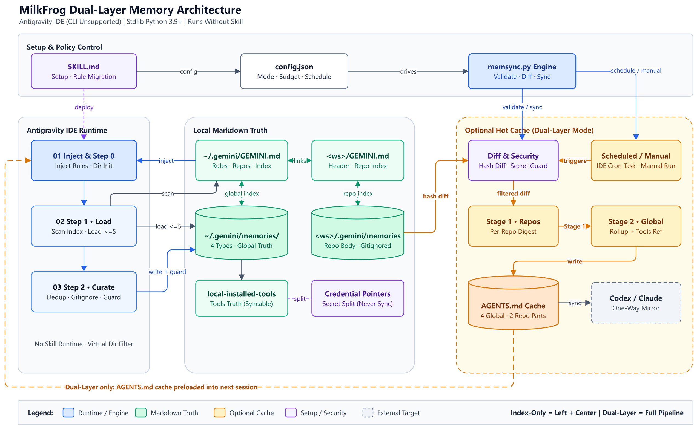

# Dual-Layer Memory Architecture & Design Rationale

> **Target Host**: Google Antigravity IDE (with optional one-way export to Codex / Claude Code).  
> **Not Supported Yet**: Antigravity CLI (`agy`) has not been tested or adapted by this skill.

> Editable Draw.io source: [architecture.drawio](../assets/architecture.drawio) · [中文版](./architecture.zh-CN.md)

## 1. Core Problems Solved

Coding agents lose two different kinds of knowledge across sessions:
1. **Behavioral constraints & pitfalls** (formatting rules, forbidden patterns, port bindings, deploy steps) — the agent needs these *before* acting, without guessing what to search for.
2. **Active project state** (what shipped, what is blocked, what architecture decision won) — split cleanly between global machine rules and individual workspaces.

Vector RAG or raw transcript search handles history lookup, not guaranteed rule compliance. A two-layer Markdown system backed by a deterministic diff script handles both without external vector databases or cloud API calls.

## 2. File Roles & Separation of Read/Write Responsibility

| Layer | Files | Purpose | Sole Writer |
| --- | --- | --- | --- |
| **Global Index & Rules** | `~/.gemini/GEMINI.md` | Runtime read/write protocol, workspace registry, and index links | Current session agent (or `memsync ws/init` on registry section) |
| **Global Entries** | `~/.gemini/memories/*.md` | Single source of truth for cross-project `user`, `feedback`, `project`, `reference` | Current session agent (bans/pitfalls/alerts immediately; others post-task) |
| **Global Hot Snapshot** | `~/.gemini/AGENTS.md` | Compact 4-section digest cached from global entries and Stage-1 workspace snapshots | `memsync.py apply --scope global` only |
| **Workspace Index** | `<workspace>/GEMINI.md` | Minimal header pointing to global rules + project index links | `memsync.py init` + current session agent |
| **Workspace Entries** | `<workspace>/.gemini/memories/*.md` | Single source of truth for repo-specific `project`, `feedback`, `reference` (gitignored) | Current session agent (bans/pitfalls/alerts immediately; others post-task) |
| **Workspace Hot Snapshot** | `<workspace>/AGENTS.md` | Compact 2-section digest of repo progress and repo-only gotchas | `memsync.py apply --scope <ws>` only |

### Optional Mode: Index-Only (`mode.agents_cache_enabled = false`)
If you consider `AGENTS.md` snapshots redundant or want minimum always-loaded context tokens, disable `agents_cache_enabled`. In index-only mode:
- No `AGENTS.md` files are created, validated, or synced; any pre-existing `AGENTS.md` in a repository stays untouched.
- Agents rely strictly on scanning `GEMINI.md` indexes and reading `memories/*.md` files on demand.
- Background scheduled distillation automatically turns off.

## 3. Key Design Trade-offs

### Why Not LFU / LRU Hot Caching?
If hot entries are distilled into `AGENTS.md` and auto-injected into every new conversation, the model answers straight from the snapshot without opening the underlying `memories/*.md` files. File access counters and timestamps stop reflecting true utility immediately. Using fixed domain sections + git-style incremental diffs keeps hot snapshots predictable.

### Why Two-Stage Incremental Diffs (`sync-state.json`)?
Re-summarizing all memories daily introduces paraphrase drift and silent omissions. Instead, `memsync.py sync-plan`:
1. Computes SHA256 hashes for every `memories/*.md` and target `AGENTS.md`.
2. Emits `[NEW]` (full body), `[MODIFIED]` (`difflib.unified_diff`), and `[DELETED]` (old description) blocks.
3. Skips any scope with zero changes (`SKIP`) without touching timestamps or files.
4. Processes **workspaces first (Stage 1)**, then runs `global-input` to roll freshly updated workspace summaries up into **global `AGENTS.md` (Stage 2)**.

### Why Antigravity Standard vs Extended Budgets?
Unmodified Antigravity IDE caps each loaded rule file (`GEMINI.md` / `AGENTS.md`) at `24,000` bytes (truncating lines beyond the cap) and budgets `20,000` tokens across always-on rules.
- `limits.profile = "standard"` (default): warns at `16 KB`, hard-blocks at `24 KB` per file so Antigravity never silently cuts off your index.
- `limits.profile = "extended"`: raises warn/hard caps to `40 KB / 160 KB` (global) and `24 KB / 96 KB` (project) for setups that expanded IDE limits.

### Why Filter Antigravity Sidecar / Swarm Virtual Projects?
Antigravity records scheduled cron runs and swarm sub-workspaces under `~/.gemini/config/projects/*.json` with `"sidecar": true` or `config.json["sidecars"]` IDs, plus `.gemini/antigravity/swarm/` clones. `memsync.py lint` strips all virtual projects and nested child folders before flagging unregistered directories.

### Security, Tooling Registry & Privacy Guardrails
- **Canonical Toolchain Registry (`memories/local-installed-tools.md`)**: Local software paths, SDK versions, package mirrors, proxy bindings, and OS quirks are intentionally consolidated into one `type: reference`, `sync: auto` entry rather than scattered across multiple files. `memsync.py doctor` can optionally seed this file by scanning common developer CLIs on `PATH`, and if `local-installed-tools.md` exists, Stage-2 distillation keeps a compact quick-reference in global `AGENTS.md` Section 4 ending with a pointer back to it.
- **Credential Pointers Stay Separate (`sync: never`)**: Entries holding pointers to API keys, SSH hosts, or server credentials live in *separate* files marked `sync: never` in YAML frontmatter and omit plain-text secrets. Never combine local tool inventories (`sync: auto`) and secret pointers (`sync: never`) in the same file, or redaction will block the toolchain quick-reference from reaching `AGENTS.md`.
- `sync-state.json` never caches body text for `sync: never` files, and `sync-plan` emits redacted metadata only.
- `apply` runs `SECRET_RE` pattern checks and refuses to write if potential credentials leak into a draft.
- `init` automatically adds `.gemini/memories/` to `.gitignore` inside git repositories.

### Optional `PreInvocation` Context Monitor Hook
Wait-until-task-end memory rules fail if auto-compaction hits mid-task after a user states a new ban or constraint. Installing the optional `milkfrog-context-hook` plugin (`memsync.py hook install`) wires a pure-stdlib `PreInvocation` hook (`context_hook.py`) that reads the active Antigravity conversation SQLite snapshot (with `transcript.jsonl` fallback) and injects compact context occupancy plus a rescue alert at `>= 80%`.

### One-Way Cross-Tool Distribution
Multi-tool bi-directional reconciliation causes constant merge drift. `memsync.py copy-global` treats `~/.gemini/AGENTS.md` as the single upstream source, backing up and overwriting configured targets such as `~/.codex/AGENTS.md` or `~/.claude/CLAUDE.md` only when global `apply` runs (or manually via `copy-global`).
