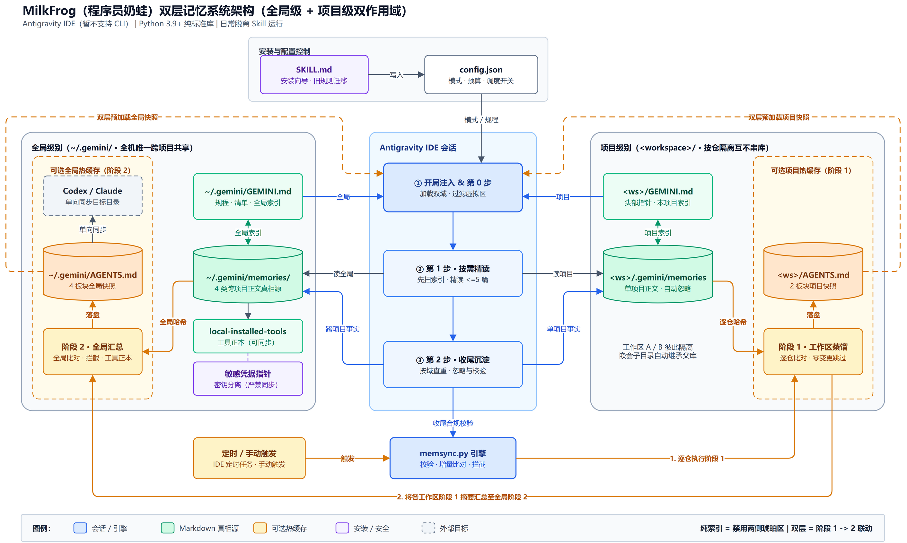

# 双层记忆系统架构与设计取舍

> **适用宿主**：Google Antigravity IDE（附可选单向分发至 Codex / Claude Code）。  
> **暂不支持**：Antigravity CLI（`agy`）尚未做过适配与实测。

> 可编辑 Draw.io 源文件：[architecture.zh-CN.drawio](../assets/architecture.zh-CN.drawio) · [英文版](./architecture.md)

## 1. 解决哪两类具体问题

开发时 AI 跨会话会丢两类完全不同的信息：
1. **行为红线与工程避坑**（字体规定、禁用写法、端口映射、发布流程）——模型必须**在动手前**就知道，靠被动搜索（RAG）往往无效，因为犯错前 AI 不知道自己该搜什么词。
2. **项目当前状态与阶段决策**（做到哪一步、哪些方案已被否定、下一步待办）——需要把全局规范和单项目进度拆开，避免打开仓库 A 时带着仓库 B 的噪音。

用双层 `GEMINI.md` 索引/正文 + 增量快照脚本，可以把这两类信息全部留在本地 Markdown 里，不依赖外部向量库或云端总结 API。

## 2. 四类文件载体与读写职责分离

| 载体 | 路径 | 职责 | 唯一写入方 |
| --- | --- | --- | --- |
| **全局索引与规程** | `~/.gemini/GEMINI.md` | 读写规程、工作区清单、全局记忆单行索引 | 日常会话结束时的当前 Agent（工作区清单由 `memsync init/ws` 维护） |
| **全局正文** | `~/.gemini/memories/*.md` | 跨工作区 `user` / `feedback` / `project` / `reference` 唯一真相源 | 当前会话 Agent（禁用项/纠偏/实测坑与 >=80% 预警当场写入，其余收尾裁决） |
| **全局热缓存快照** | `~/.gemini/AGENTS.md` | 由全局正文与阶段 1 工作区摘要蒸馏出的 4 板块压缩视图 | 仅限 `memsync.py apply --scope global` |
| **项目索引** | `<workspace>/GEMINI.md` | 极简头部指针 + 本项目单行索引 | `memsync.py init` + 当前会话 Agent |
| **项目正文** | `<workspace>/.gemini/memories/*.md` | 单项目独有进展与坑位正文（git 仓自动忽略） | 当前会话 Agent（禁用项/纠偏/实测坑与 >=80% 预警当场写入，其余收尾裁决） |
| **项目热缓存快照** | `<workspace>/AGENTS.md` | 仅包含本项目进展与专属坑位的 2 板块摘要 | 仅限 `memsync.py apply --scope <ws>` |

### 可选关闭缓存：纯索引模式（`mode.agents_cache_enabled = false`）
如果你认为额外维护一份 `AGENTS.md` 属于冗余、或者只想把首轮上下文占用压到最低，可以在初始化时关闭 `agents_cache_enabled`：
- 系统全程**不生成也不检查任何 `AGENTS.md`**，仓库里他人原有的 `AGENTS.md` 保持原样不动；
- 日常每次开对话直接扫 `GEMINI.md` 索引，按需读取 `memories/*.md`；
- 后台定时蒸馏同步随之自动关闭。

## 3. 核心设计取舍

### 为什么放弃 LFU / LRU 自动热度淘汰？
一旦把“热门记忆”提炼进 `AGENTS.md` 常驻注入上下文，模型就能直接命中热缓存而不再去读底下的 `memories/*.md`。文件访问计数与最近读取时间会立刻失真。因此改用**固定板块结构 + 每日/手动 sha256 diff 增量更新**，保证重要规则不会因为长期没踩坑就被淘汰掉。

### 为什么用两阶段 Diff（`sync-state.json`）而不是全量重写？
让模型每天从零重读全部记忆重新总结，很容易出现改写漂移和漏条。`memsync.py sync-plan` 的做法是：
1. 比对每个作用域当前 `memories/*.md` 和目标 `AGENTS.md` 的 `sha256` 与 `sync-state.json` 基线。
2. 仅输出 `[NEW]`（新全文）、`[MODIFIED]`（`unified_diff`）与 `[DELETED]`（旧摘要提醒）给模型做局部修订。
3. 0 变更的作用域直接输出 `SKIP`，不重写文件、不碰时间戳。
4. 先跑**阶段 1（各工作区）**，再用 `global-input` 把刚更新好的各工作区快照汇总进**阶段 2（全局 `AGENTS.md`）**。

### 为什么默认用 `standard`（24 KB）预算档位？
未修改的原版 Antigravity IDE 对每个 `GEMINI.md` / `AGENTS.md` 规则文件设有 `24,000` 字节硬上限（超出部分会在行边界被静默截断），且总常驻规则预算为 `20,000` tokens。
- `standard` 档（默认）：单文件 `16 KB` 警告、`24 KB` 硬阻断，确保规则文件永远不会被 IDE 静默截断；
- `extended` 档：针对自行解除上下文限制的用户，提供 `40 KB / 160 KB`（全局）与 `24 KB / 96 KB`（项目）的高阈值配置。

### 如何隔离 Antigravity 虚拟项目？
Antigravity 的后台定时任务和 Swarm 多 Agent 看板会在 `~/.gemini/config/projects/*.json` 下产生带 `"sidecar": true` 标记的虚拟项目，并在 `.gemini/antigravity/swarm/` 下产生工作拷贝。`memsync.py lint` 巡检未纳管目录时会自动剔除这些虚拟条目及已注册工作区的子目录，避免误报警。

### 工具正本约定与敏感配置隔离
- **本机工具唯一正本（`memories/local-installed-tools.md`）**：所有本机已装软件、SDK 路径、包管理镜像、代理端口与系统级踩坑约定，统一收口在全局 **`local-installed-tools.md`**（`type: reference`、`sync: auto`），不按单个软件拆成十几个碎片文件。安装时可用 `doctor` 只读探测常见命令快速建出初稿；只要该文件存在，阶段 2 就会将其摘要写进全局 `AGENTS.md` 第四节并在节末挂上指向它的指针。
- **凭据指针严格分家（`sync: never`）**：指向 API Key、私钥或服务器登录方式的文件单独成篇，必须在 frontmatter 标 `sync: never` 且禁写明文。**绝不把工具清单（`sync: auto`）和凭据指针（`sync: never`）混写在同一篇里**，否则整篇脱敏会顺带把工具速查挡在 `AGENTS.md` 外面。
- `sync-state.json` 对 `sync: never` 条目不缓存正文内容，`sync-plan` 只输出脱敏描述。
- `apply` 阶段会做 `SECRET_RE` 正则拦截，疑似密钥明文直接拒写。
- `init` 在 `.git` 仓库内自动把 `.gemini/memories/` 追加进 `.gitignore`。

### 可选 `PreInvocation` 上下文占用监控 Hook
如果长任务还没结束就触发了压缩，只在任务结束才写记忆的规则容易漏掉中途刚定下的禁用项和踩坑。通过 `memsync.py hook install` 自动挂载的 `milkfrog-context-hook` 插件会在模型调用前执行纯标准库脚本 `context_hook.py`，只读当前会话 SQLite 快照（失败回退 `transcript.jsonl`）；默认 **80% 以下静默**，达到 **≥80%** 时注入记忆抢救提醒，并通过反向扫描 `transcript.jsonl` 尾部做无状态频控（默认每 **3** 次模型调用最多提醒 1 次，冷却期内首次冲过 **≥92%** 危急线破例立即补提醒 1 次，零额外状态文件）。

### 单向跨端同步（不做双向对账）
多端双向同步极易互相覆盖冲突。本方案把全局 `AGENTS.md` 视为唯一上游，仅在阶段 2 `apply --scope global` 成功后（或手跑 `copy-global`），自动备份旧文件并单向覆盖配置好的外部目标（如 `~/.codex/AGENTS.md`、`~/.claude/CLAUDE.md`）。
